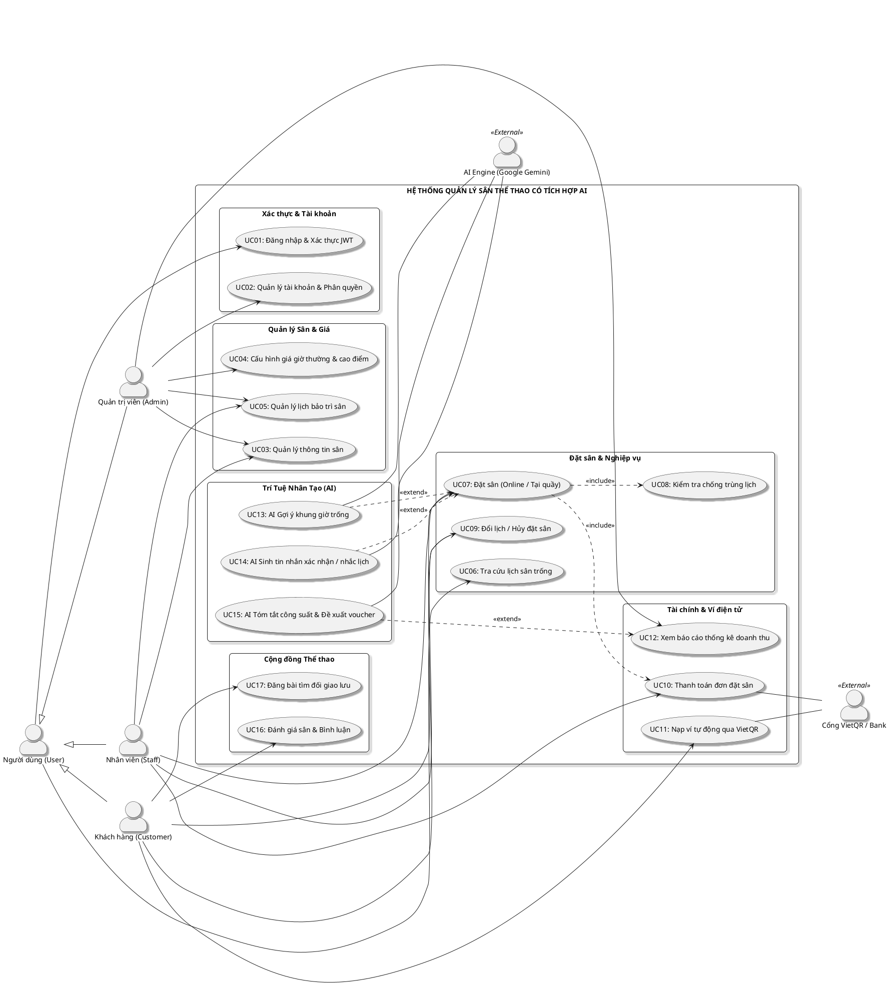
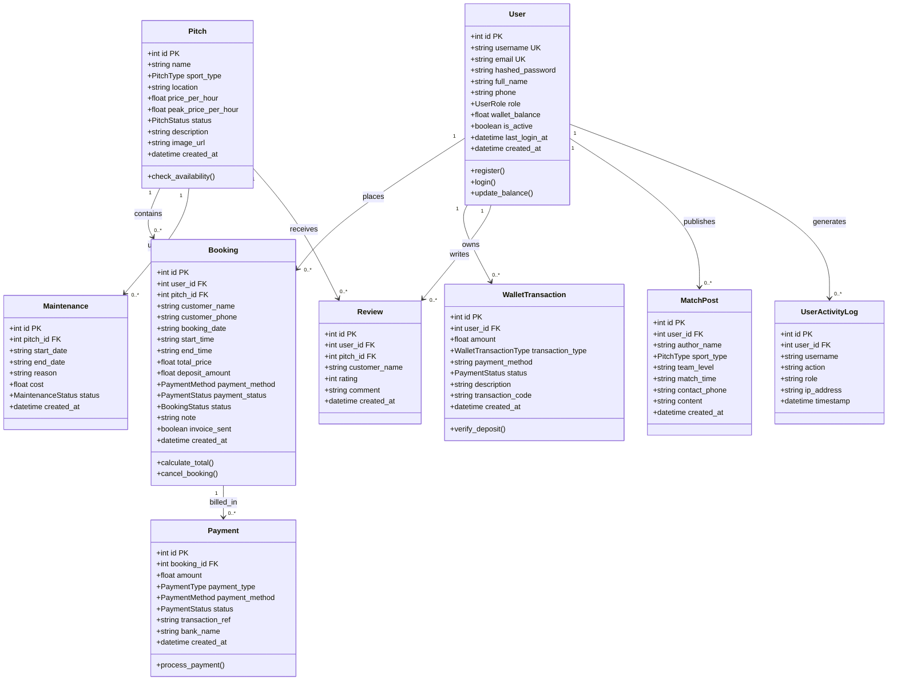
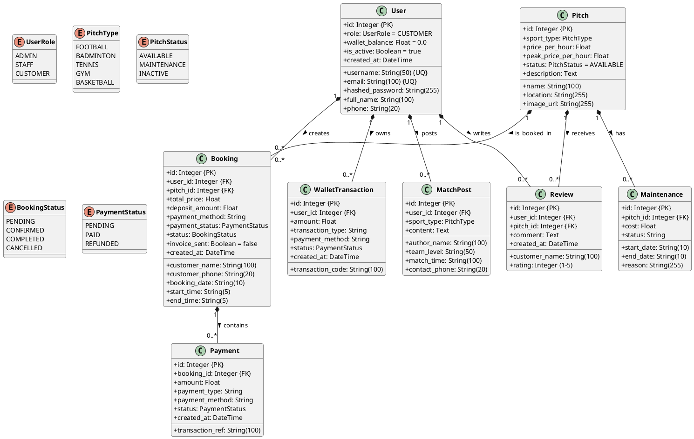
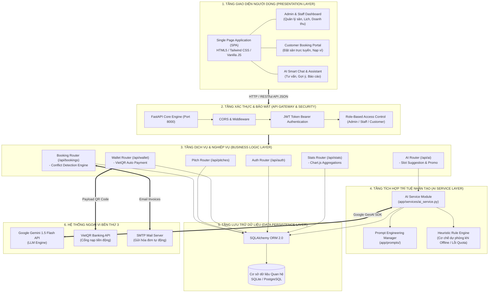
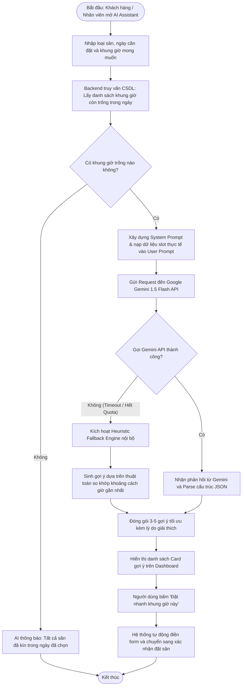
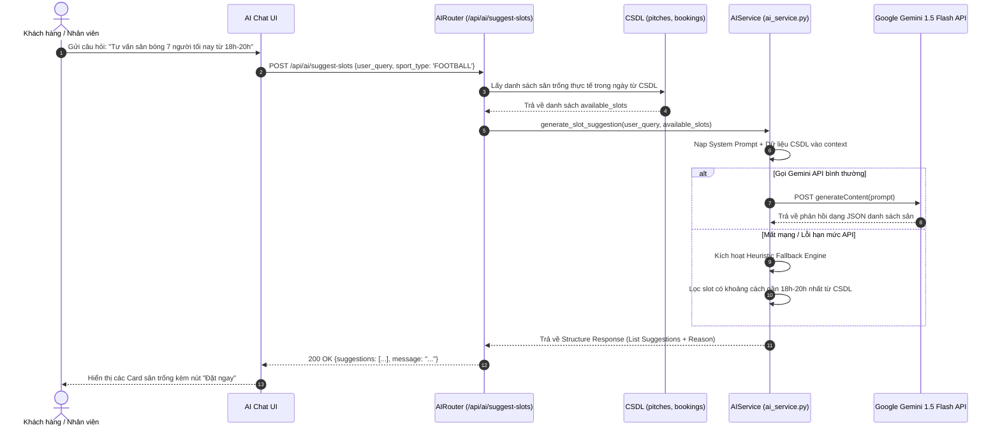
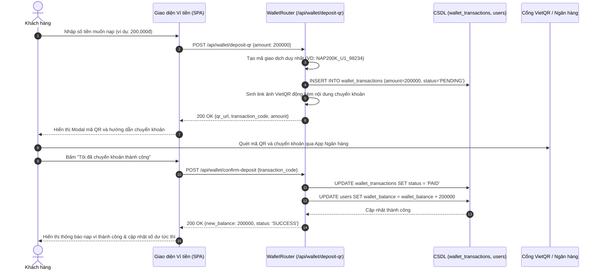

# TÀI LIỆU THIẾT KẾ HỆ THỐNG & TỔNG HỢP TOÀN BỘ SƠ ĐỒ UML
## DỰ ÁN: HỆ THỐNG QUẢN LÝ SÂN THỂ THAO CÓ TÍCH HỢP TRÍ TUỆ NHÂN TẠO (AI)
**Học phần:** Ứng dụng Trí tuệ Nhân tạo (AIA331)  
**Nhóm thực hiện:** Nhóm 03  
**Tệp dự án StarUML đính kèm mở trực tiếp:** `F:\Du_An_San_The_Thao_StarUML.mdj`

---

# PHẦN 1. BÁO CÁO PHÂN TÍCH & PHẢN BIỆN CỦA CHUYÊN GIA THIẾT KẾ HỆ THỐNG

### 1.1. Đánh giá về các Tác nhân (Actors) - Đã đúng và đủ hay chưa?

#### A. Thực trạng trong file Word báo cáo hiện tại:
Trong tài liệu báo cáo `BAI DU AN_UNG DUNG AI_Nhom 03.docx` (Mục 2.2.1), nhóm chỉ liệt kê **3 tác nhân con người**:
1. `Admin` (Quản trị viên): Quản lý toàn bộ hệ thống sân, giá, nhân viên, báo cáo.
2. `Staff` (Nhân viên): Đặt sân, thanh toán, quản lý khách hàng, xem báo cáo cơ bản.
3. `Customer` (Khách hàng): Xem lịch trống và đặt sân (tài liệu ghi "trong tương lai mở rộng, hiện tại chưa cấp tài khoản").

#### B. Phản biện & Đánh giá chuyên sâu của Chuyên gia:
1. **THIẾU CÁC ACTOR HỆ THỐNG NGOẠI VI (Secondary / External System Actors):**
   - Hệ thống có tích hợp AI và cổng thanh toán tự động, do đó **bắt buộc** phải xác định các tác nhân ngoại vi tương tác trao đổi dữ liệu với hệ thống:
     * **`AI Service Engine (Google Gemini API / OpenAI LLM)`**: Tác nhân ngoại vi tiếp nhận prompt ngữ cảnh từ Backend, xử lý phân tích ngôn ngữ tự nhiên và trả về JSON gợi ý sân trống, nội dung thông báo, hoặc tóm tắt báo cáo.
     * **`Payment Gateway / Banking System (VietQR / MoMo / Napas)`**: Tác nhân ngoại vi cung cấp mã thanh toán QR động, xác thực giao dịch chuyển khoản và trả webhook/đối soát nạp tiền ví.
     * **`Notification Service (SMTP Email Server / Zalo OA API)`**: Tác nhân ngoại vi tiếp nhận yêu cầu gửi email hóa đơn và tin nhắn nhắc lịch tự động cho khách hàng.
2. **THIẾU QUAN HỆ KẾ THỪA GIỮA CÁC ACTOR (Generalization):**
   - Cả 3 tác nhân `Admin`, `Staff`, và `Customer` đều có các hành vi dùng chung: *Đăng nhập*, *Đổi mật khẩu*, *Xem danh sách sân*, *Xem bảng giá*.
   - Theo chuẩn thiết kế hướng đối tượng (OOAD), cần định nghĩa một Actor cha trừu tượng là **`User (Người dùng hệ thống)`**. Sau đó `Admin`, `Staff`, và `Customer` kế thừa (`Generalization`) từ `User`. Điều này giúp biểu đồ Use Case gọn gàng, mạch lạc, tránh lặp lại đường nối (associations).
3. **SỰ MÂU THUẪN GIỮA FILE BÁO CÁO VÀ CODEBASE THỰC TẾ:**
   - Trong file Word: Ghi `Customer` chưa có tài khoản, đặt sân qua nhân viên.
   - Trong mã nguồn thực tế (`F:\Du_An_San_The_Thao`): `Customer` đã có tài khoản riêng (`role = CUSTOMER`), có ví điện tử cá nhân (`wallet_balance`), tự nạp tiền qua VietQR, tự tìm kiếm sân với AI, tự đặt sân online, viết đánh giá 5 sao (`Review`) và đăng bài tìm đối giao lưu (`MatchPost`).
   - **Kết luận chuyên gia:** Cần cập nhật `Customer` thành **Primary Actor chính thức** trong Use Case để phản ánh đúng năng lực hệ thống thực tế.

---

### 1.2. Đánh giá về Mối quan hệ (Relationships) trong Hệ thống

#### A. Trong Biểu đồ Use Case:
1. **Mối quan hệ `<<include>>` (Bắt buộc):**
   - *Đặt sân (Booking)* `<<include>>` *Kiểm tra tính khả dụng & Chống trùng lịch (Check Availability)*: Không thể tạo đơn đặt sân nếu chưa qua bước kiểm tra trùng lịch.
   - *Thực hiện các tác vụ quản trị / đặt sân* `<<include>>` *Đăng nhập & Xác thực quyền (Authentication & Authorization)*.
   - *Hủy đặt sân hoàn tiền* `<<include>>` *Cập nhật số dư ví điện tử*.
2. **Mối quan hệ `<<extend>>` (Mở rộng tùy chọn / Có điều kiện):**
   - *Đặt sân* `<--<<extend>>--` *Gợi ý khung giờ bằng AI (AI Slot Suggestion)*: Khi khách hàng phân vân chưa biết chọn giờ nào hoặc giờ mong muốn đã kín, AI sẽ được kích hoạt để đưa ra gợi ý thay thế.
   - *Xác nhận đặt sân* `<--<<extend>>--` *Tự động sinh tin nhắn thông báo AI (AI Notification)*.
   - *Xem thống kê doanh thu* `<--<<extend>>--` *AI Tóm tắt công suất & Đề xuất voucher giờ thấp điểm*.
   - *Thanh toán* `<--<<extend>>--` *Nạp tiền ví tự động qua VietQR*.

#### B. Trong Mô hình Dữ liệu ERD & Class Diagram:
1. **Bất cập của bảng `TimeSlot` trong bản thiết kế Word cũ:**
   - Bản vẽ cũ trong Word thiết kế bảng `TimeSlot` lưu sẵn từng ô giờ cố định theo ngày. Điều này làm phát sinh hàng chục nghìn dòng dữ liệu rỗng và không hỗ trợ khách muốn thuê thời lượng linh hoạt (ví dụ 1.5 tiếng: 17:30 - 19:00).
2. **Chuẩn hóa theo mô hình Codebase thực tế:**
   - Dùng thực thể `Booking` lưu trực tiếp `start_time`, `end_time`, `booking_date` kết hợp truy vấn kiểm tra giao thoa động. CSDL cực kỳ tinh gọn, hiệu năng cao và đáp ứng mọi khung giờ thuê.
3. **Mối quan hệ thực thể chuẩn:**
   - `User` (1) ---- (0..*) `Booking`: Một người dùng có thể đặt nhiều đơn.
   - `Pitch` (1) ---- (0..*) `Booking`: Một sân tiếp nhận nhiều lượt đặt trong các khung giờ khác nhau.
   - `Booking` (1) ---- (1..*) `Payment`: Một đơn đặt sân có thể có nhiều đợt thanh toán (Đặt cọc -> Tất toán).
   - `Pitch` (1) ---- (0..*) `Maintenance`: Một sân có nhiều lịch bảo trì kỹ thuật.
   - `User` (1) ---- (0..*) `WalletTransaction`: Một người dùng có nhiều giao dịch biến động số dư ví.
   - `User` (1) ---- (0..*) `Review` & `MatchPost`: Tương tác cộng đồng thể thao.

---

# PHẦN 2. TỔNG HỢP TOÀN BỘ CÁC SƠ ĐỒ CHƯA VẼ TRONG BÁO CÁO

---

## 2.1. HÌNH 2.1 – SƠ ĐỒ USE CASE TỔNG QUÁT HỆ THỐNG

### Mã Mermaid:
```mermaid
flowchart TB
    %% Actors
    subgraph Human_Actors ["Tác nhân Người dùng"]
        User["fa:fa-user Người dùng (User)"]
        Admin["fa:fa-user-shield Quản trị viên (Admin)"]
        Staff["fa:fa-id-badge Nhân viên (Staff)"]
        Customer["fa:fa-running Khách hàng (Customer)"]
    end

    subgraph External_Actors ["Tác nhân Ngoại vi"]
        AI["fa:fa-robot AI Engine (Google Gemini)"]
        Bank["fa:fa-university Cổng VietQR / Ngân hàng"]
    end

    %% Generalization
    Admin --|> User
    Staff --|> User
    Customer --|> User

    %% Subsystems & Use Cases
    subgraph System_Boundary ["HỆ THỐNG QUẢN LÝ SÂN THỂ THAO CÓ TÍCH HỢP AI"]
        
        subgraph Auth_Subsystem ["Phân hệ Xác thực & Tài khoản"]
            UC_Login(["UC01: Đăng nhập & Xác thực JWT"])
            UC_Profile(["UC02: Quản lý thông tin cá nhân"])
            UC_ManageUser(["UC03: Quản lý tài khoản & Phân quyền"])
        end

        subgraph Pitch_Subsystem ["Phân hệ Quản lý Sân & Bảng giá"]
            UC_Pitch(["UC04: Quản lý thông tin & Trạng thái sân"])
            UC_Price(["UC05: Cấu hình giá (Thường & Cao điểm)"])
            UC_Maint(["UC06: Lập lịch & Quản lý bảo trì sân"])
        end

        subgraph Booking_Subsystem ["Phân hệ Đặt sân & Lịch thi đấu"]
            UC_ViewSlots(["UC07: Tra cứu lịch sân trống"])
            UC_Booking(["UC08: Đặt sân trực tuyến / Tại quầy"])
            UC_Conflict(["UC09: Kiểm tra chống trùng lịch"])
            UC_Cancel(["UC10: Hủy đặt sân & Hoàn tiền ví"])
        end

        subgraph Payment_Subsystem ["Phân hệ Tài chính & Ví điện tử"]
            UC_Pay(["UC11: Thanh toán đơn đặt sân"])
            UC_Deposit(["UC12: Nạp tiền ví qua VietQR tự động"])
            UC_Stats(["UC13: Xem thống kê & Doanh thu"])
        end

        subgraph AI_Subsystem ["Phân hệ Trí Tuệ Nhân Tạo (AI)"]
            UC_AISuggest(["UC14: AI Tư vấn & Gợi ý khung giờ"])
            UC_AINotif(["UC15: AI Tự động sinh tin nhắn thông báo"])
            UC_AIReport(["UC16: AI Tóm tắt công suất & Gợi ý voucher"])
        end

        subgraph Community_Subsystem ["Phân hệ Cộng đồng & Đánh giá"]
            UC_Review(["UC17: Đánh giá sân & Xếp hạng 5 sao"])
            UC_Match(["UC18: Đăng tin tìm đối giao lưu"])
        end
    end

    %% Relationships
    User --> UC_Login
    User --> UC_Profile
    User --> UC_ViewSlots

    Admin --> UC_ManageUser
    Admin --> UC_Pitch
    Admin --> UC_Price
    Admin --> UC_Maint
    Admin --> UC_Stats

    Staff --> UC_Pitch
    Staff --> UC_Maint
    Staff --> UC_Booking
    Staff --> UC_Cancel
    Staff --> UC_Pay

    Customer --> UC_Booking
    Customer --> UC_Cancel
    Customer --> UC_Deposit
    Customer --> UC_Review
    Customer --> UC_Match

    %% Include & Extend
    UC_Booking -.->|"<<include>>"| UC_Conflict
    UC_Booking -.->|"<<include>>"| UC_Pay
    UC_Cancel -.->|"<<include>>"| UC_Deposit

    UC_AISuggest -.->|"<<extend>>"| UC_Booking
    UC_AINotif -.->|"<<extend>>"| UC_Booking
    UC_AIReport -.->|"<<extend>>"| UC_Stats

    %% External Connections
    UC_AISuggest --- AI
    UC_AINotif --- AI
    UC_AIReport --- AI
    UC_Deposit --- Bank
    UC_Pay --- Bank
```

### Mã PlantUML:


---

## 2.2. HÌNH 2.2 – SƠ ĐỒ THỰC THỂ QUAN HỆ (ERD) & BIỂU ĐỒ LỚP (CLASS DIAGRAM)

### Mã Mermaid:


### Mã PlantUML:


---

## 2.3. HÌNH 2.3 – SƠ ĐỒ KIẾN TRÚC HỆ THỐNG TỔNG THỂ (SYSTEM ARCHITECTURE)

### Mã Mermaid:


---

## 2.4. HÌNH 2.4 – SƠ ĐỒ LUỒNG XỬ LÝ CHỨC NĂNG AI GỢI Ý KHUNG GIỜ (ACTIVITY DIAGRAM)

### Mã Mermaid:


---

## 2.5. CÁC SƠ ĐỒ TUẦN TỰ TRỌNG TÂM (SEQUENCE DIAGRAMS)

### SD01: Sơ đồ Tuần tự Đăng nhập & Xác thực JWT
```mermaid
sequenceDiagram
    autonumber
    actor Actor as Người dùng (Admin / Staff / Customer)
    participant UI as Giao diện Frontend (SPA)
    participant AuthRouter as AuthRouter (/api/auth/login)
    participant DB as CSDL (users table)

    Actor->>UI: Nhập Username và Password
    UI->>AuthRouter: POST /api/auth/login {username, password}
    AuthRouter->>DB: Query User where username = :username and is_active = True
    DB-->>AuthRouter: Trả về User record (kèm hashed_password)
    
    alt Không tìm thấy User hoặc sai Mật khẩu
        AuthRouter-->>UI: 401 Unauthorized ("Sai thông tin đăng nhập")
        UI-->>Actor: Hiển thị thông báo lỗi
    else Xác thực bcrypt thành công
        AuthRouter->>AuthRouter: Tạo JWT Token (chứa user_id, username, role, exp)
        AuthRouter->>DB: Cập nhật last_login_at
        AuthRouter-->>UI: 200 OK {access_token, role, full_name, wallet_balance}
        UI->>UI: Lưu Token & User info vào LocalStorage
        UI->>UI: Chuyển hướng Dashboard theo Role (Admin / Staff / Customer)
        UI-->>Actor: Hiển thị giao diện làm việc
    end
```

---

### SD02: Sơ đồ Tuần tự Đặt sân & Thuật toán Chống trùng lịch (Double-Booking Prevention)
```mermaid
sequenceDiagram
    autonumber
    actor Customer as Khách hàng / Nhân viên
    participant UI as Giao diện Đặt sân (SPA)
    participant BookingRouter as BookingRouter (/api/bookings)
    participant DB as CSDL (bookings table)
    participant WalletRouter as Wallet / Payment Service

    Customer->>UI: Chọn Sân, Ngày, Giờ bắt đầu (S), Giờ kết thúc (E)
    UI->>BookingRouter: POST /api/bookings {pitch_id, date, S, E, payment_method}
    
    BookingRouter->>DB: Query kiểm tra trùng lịch:
(booking_date == date) AND (pitch_id == id) AND
(status != 'CANCELLED') AND (S < end_time) AND (E > start_time)
    DB-->>BookingRouter: Trả về danh sách đơn trùng (nếu có)
    
    alt Phát hiện trùng lịch (Overlap > 0)
        BookingRouter-->>UI: 409 Conflict ("Khung giờ đã có người đặt hoặc đang bảo trì")
        UI-->>Customer: Báo lỗi và gợi ý khung giờ khác
    else Khung giờ hợp lệ (Không trùng)
        BookingRouter->>BookingRouter: Tính toán tổng tiền (nhân hệ số cao điểm nếu sau 17h00)
        
        alt Thanh toán bằng Ví điện tử
            BookingRouter->>WalletRouter: Kiểm tra & Khấu trừ số dư ví
            WalletRouter-->>BookingRouter: Khấu trừ thành công
        end
        
        BookingRouter->>DB: INSERT INTO bookings (status='CONFIRMED', payment_status='PAID')
        DB-->>BookingRouter: Trả về booking_id mới
        BookingRouter-->>UI: 201 Created {booking_id, status: 'CONFIRMED'}
        UI-->>Customer: Hiển thị thông báo đặt sân thành công & mã đơn
    end
```

---

### SD03: Sơ đồ Tuần tự AI Tư vấn & Gợi ý Sân thông minh


---

### SD04: Sơ đồ Tuần tự Nạp tiền Ví điện tử tự động qua VietQR


---

# PHẦN 3. HƯỚNG DẪN MỞ & XUẤT ẢNH TRÊN STARUML

1. **Bước 1:** Khởi động phần mềm **StarUML** trên máy tính.
2. **Bước 2:** Chọn menu **File** -> **Open...** -> Trỏ đến tệp tin: `F:\Du_An_San_The_Thao_StarUML.mdj`.
3. **Bước 3:** Ở khung **Model Explorer** (bên phải màn hình), bạn sẽ thấy 2 thư mục mô hình chính:
   - `1. Use Case Model (Hinh 2.1)` -> Nháy đúp vào `Hinh 2.1 - So do Use Case Tong Quat He Thong` để xem và chỉnh sửa giao diện.
   - `2. Class Diagram & ERD (Hinh 2.2)` -> Nháy đúp vào `Hinh 2.2 - So do ERD & Class Model CSDL` để xem toàn bộ cấu trúc bảng và kiểu dữ liệu.
4. **Bước 4:** Để xuất ảnh chèn vào Word:
   - Chọn menu **File** -> **Export Diagram As** -> Chọn định dạng **PNG...** hoặc **JPEG...**.
   - Lưu ảnh với độ phân giải cao và dán vào đúng vị trí các hình trong file Word báo cáo!
